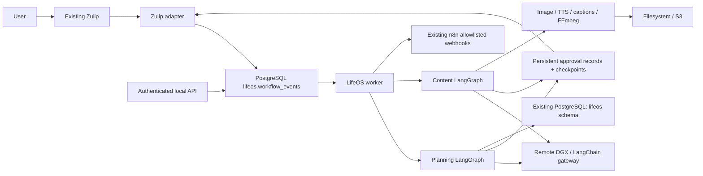

# Architecture

The bot registers a Zulip message event queue, long-polls, and enqueues commands
using message IDs as durable deduplication keys. User allowlisting happens before
routing. DMs must contain only bot and sender; streams must be explicitly
allowlisted private channels. These commands never bind arbitrary model tools.

The worker claims jobs with SELECT FOR UPDATE SKIP LOCKED and a bounded lease.
A PostgreSQL advisory transaction lock covers each run across graph execution.
A crash releases the lock; an expired lease makes work reclaimable. Graph calls
use synchronous checkpoint durability. Jobs resume the retained checkpoint,
not their original input, and an old resume token cannot approve a later stage.
Failure states are recorded and retried up to three delivery attempts.

Each approval has a UUID, owner, run ID, stage, reviewed payload, expiration,
status and audited decision. Its creation is idempotent on (run, stage). The
approval node calls interrupt(); Command(resume=...) only carries the approval
ID. The graph re-reads the authoritative database decision and refuses forged
resumes. Decisions and resume outbox insertion share one transaction. A periodic
worker sweep expires pending approvals and resumes their graphs as rejections.

Planning business writes have a unique run ID and one database transaction.
Already persisted plans return their existing ID. Scheduled/updated tasks are
checked again for ownership and modification timestamps after review. Invalid
or stale plans fail rather than silently modifying a different proposal.
Content writes are internal run metadata/assets after approved production;
review approval gates final MP4 export. Uploaded assets are never automatically
published to YouTube.

`lifeos` holds 15 application tables plus Alembic and LangGraph checkpoint tables.
Migration and runtime roles are separate. Checkpoint setup uses search_path=lifeos
and runs only as a migration step. No unrelated schema tables are modified.
Sessions and budgets are scoped to Zulip user IDs, not email addresses.

Outbox jobs make queued integrations recoverable, not magically exactly once.
A remote service might accept a request just before the worker crashes. n8n
workflows must deduplicate Idempotency-Key; Zulip does not guarantee deduplicated
message creation. Media files use deterministic per-run filenames and atomic
writes; already saved assets are reused on node replay. A provider response lost
before local persistence may require another billed call. S3 publication uses
stable object keys; the named filesystem volume remains the shared working cache.

The application contains no arbitrary Python/shell/SQL/HTTP execution tool.
Database statements are fixed SQLAlchemy operations. Provider URLs are configured
by the operator, never by the model. Image URL responses are rejected; only
validated base64 image data is accepted. FFmpeg receives a fixed argument list,
validated filenames and bounded timing; it does not execute a shell.
